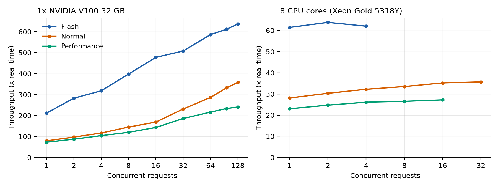
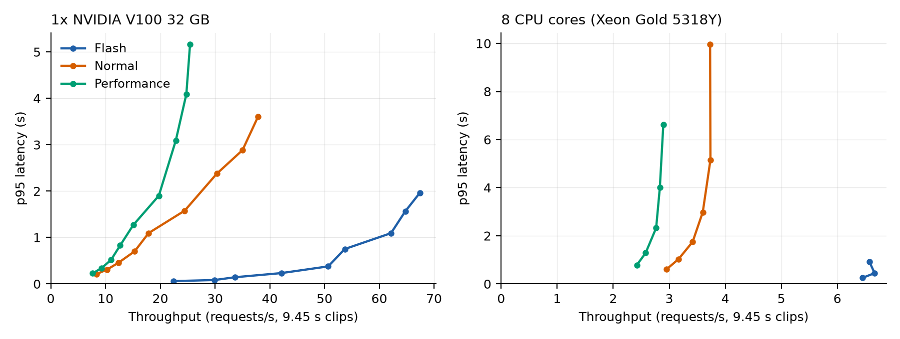
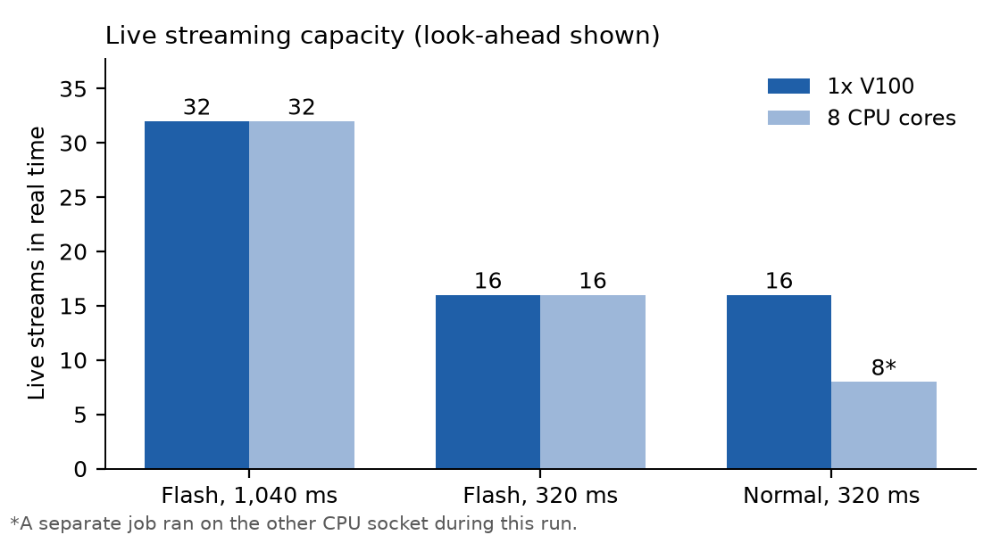

# Load test

Throughput and latency of this server under concurrent load, on one NVIDIA V100 and on 8 CPU cores. One server
process kept every mode loaded at once (Flash, Normal and Performance for files, Flash and Normal for live streams),
as a production deployment would. All requests succeeded: no errors, no 503 responses and no dropped streams.

## Summary

| | 1x V100 32 GB | 8 CPU cores |
|---|---|---|
| Flash (`ctc`), files | 67 req/s, 640x real time | 6.7 req/s, 64x real time |
| Normal (`decoder`), files | 38 req/s or more, 360x real time or more | 3.7 req/s, 35x real time |
| Performance (`decoder` + beam 4), files | 25 req/s, 240x real time | 2.8 req/s, 27x real time |
| Flash streams, 1,040 ms look-ahead | 32 live streams | 32 live streams |
| Flash streams, 320 ms look-ahead | 16 live streams | 16 live streams |
| Normal streams, 320 ms look-ahead | 16 live streams | 8 live streams* |

File throughput is the rate at the saturation point (the highest level tested on the V100) for clips of 9.45 s on
average. "x real time" is seconds of audio
transcribed per second of wall time. The stream count was tested in doublings, so the real stream capacity lies between the value shown and twice that. Streams count as served
when the 95th percentile of the processing delay across all streams stays below the chunk length, the delay does not grow over a 2-minute session, and no message is lost.

\*During the CPU Normal-stream run, a separate job was using the other CPU socket.

These figures are not comparable with the throughput table in README.md, which comes from a batch benchmark (fp16
graphs on GPU, 16 threads on CPU). This test ran the released fp32 packages, kept all modes loaded and timed each HTTP request end to end.

## Files: throughput and latency

Closed loop: c clients each send a request and wait for its answer before sending the next.

**V100**

| Mode | c | req/s | x real time | p50 | p95 |
|---|---|---|---|---|---|
| Flash | 1 | 22.6 | 212 | 0.04 s | 0.06 s |
| Flash | 64 | 62.3 | 586 | 1.01 s | 1.09 s |
| Flash | 128 | 67.4 | 637 | 1.83 s | 1.96 s |
| Normal | 1 | 8.5 | 79 | 0.12 s | 0.21 s |
| Normal | 64 | 30.7 | 287 | 2.03 s | 2.37 s |
| Normal | 128 | 38.2 | 358 | 3.19 s | 3.61 s |
| Performance | 1 | 7.6 | 73 | 0.13 s | 0.23 s |
| Performance | 96 | 24.8 | 234 | 3.65 s | 4.09 s |
| Performance | 128 | 25.4 | 241 | 4.72 s | 5.16 s |

req/s is the median of three runs at each level shown. "x real time", p50 and p95 come from the first run. The c=96
and c=128 levels come from a second run after the c=1 to 64 sweep. Flash still gained 8% from c=64 to c=128, about 4%
per step. Performance gained under 3% from c=96 to c=128. Normal was still gaining 9% from c=96 to c=128, where its
p95 latency is already 3.6 s, so its 38 req/s is a lower bound.

**8 CPU cores**

| Mode | c | req/s | x real time | p50 | p95 |
|---|---|---|---|---|---|
| Flash | 1 | 6.5 | 61 | 0.15 s | 0.25 s |
| Flash | 2 | 6.7 | 64 | 0.28 s | 0.45 s |
| Normal | 1 | 3.0 | 28 | 0.33 s | 0.61 s |
| Normal | 16 | 3.7 | 35 | 4.25 s | 5.16 s |
| Performance | 1 | 2.4 | 23 | 0.40 s | 0.78 s |
| Performance | 8 | 2.8 | 27 | 2.78 s | 4.01 s |

On CPU, Flash saturates at c=2, Normal at c=16 and Performance at c=8. A single request already keeps most cores busy,
so concurrency adds little throughput and mostly adds waiting time.

**Latency at a steady arrival rate.** Requests arrive at random (Poisson) at a fraction of the closed-loop rate. On
the V100 the fractions were taken against the c=64 rates (62.3 req/s for Flash, 30.7 req/s for Normal). Rates in parentheses are the achieved req/s. The random arrival draw can land off target: it offered 83% instead of 90% in the V100 Normal row and 47%
instead of 50% in the CPU Flash row.

| Hardware | Mode | Load | p50 | p95 |
|---|---|---|---|---|
| V100 | Flash | 50% of c=64 (30 req/s) | 0.07 s | 0.15 s |
| V100 | Flash | 90% of c=64 (55 req/s) | 0.38 s | 0.77 s |
| V100 | Normal | 50% of c=64 (15 req/s) | 0.55 s | 1.03 s |
| V100 | Normal | 90% of c=64, 83% offered (25 req/s) | 1.19 s | 1.77 s |
| CPU | Flash | 50% (3.2 req/s) | 0.19 s | 0.59 s |
| CPU | Flash | 90% (5.8 req/s) | 1.13 s | 4.59 s |
| CPU | Normal | 50% (1.8 req/s) | 0.65 s | 1.56 s |
| CPU | Normal | 90% (3.3 req/s) | 2.18 s | 4.38 s |

**Long recordings.** Twelve recordings of about 3 minutes each, cut at pauses by the server. Values are x real time
from a single pass over the 12 recordings (3 to 8 s of wall time on the V100), so treat them as indicative.

| Mode | V100, 1 client | V100, 4 clients | CPU, 1 client | CPU, 4 clients |
|---|---|---|---|---|
| Flash | 693x | 804x | 76x | 82x |
| Normal | 349x | 475x | 53x | 61x |
| Performance | 278x | 350x | 38x | 40x |

## Live streams

Each client streams a recorded Thai session of about 2 minutes over the WebSocket in real time, 80 ms per message,
and the client count N doubles until the server falls behind. The table gives the largest N that passed three
repeated runs, and the median lag p95 across those runs.

| Mode | Chunk | V100 streams | V100 lag p95 | CPU streams | CPU lag p95 |
|---|---|---|---|---|---|
| Flash, 1,040 ms look-ahead | 1.12 s | 32 | 0.020 s | 32 | 0.134 s |
| Flash, 320 ms look-ahead | 0.40 s | 16 | 0.019 s | 16 | 0.116 s |
| Normal, 320 ms look-ahead | 0.40 s | 16 | 0.040 s | 8* | 0.125 s |

At the next doubling the server falls behind and the delay grows over the session. No stream errors or drops occurred
at any N. Text appears after its whole chunk has arrived. At capacity, the median first partial result arrived 0.9 to
1.3 s after the first audio at 320 ms look-ahead and 1.2 to 1.3 s at 1,040 ms. The median final result arrived 0.07
to 0.08 s after the end of the audio on the V100 and 0.15 to 0.17 s on CPU.

\*See the note under the summary.

## Accuracy under load

No material accuracy change was seen under load. On the same 200 clips, offline error rates at the highest load stayed within
0.08 points of a single client. Streaming error rates were identical at N=1 and at capacity on the three sessions
common to both. Single-client error rates on the 200-clip set (CER for Thai and Chinese, WER for English):

| Mode | Thai CER | Chinese CER | English WER |
|---|---|---|---|
| Flash | 5.6% | 7.7% | 13.0% |
| Normal | 4.5% | 8.6% | 10.7% |
| Performance | 4.6% | 8.4% | 10.3% |

This set is small and serves only to check the output under load. See the model cards for benchmark results.

## Memory

| | Idle | Peak |
|---|---|---|
| V100 GPU memory | 7.7 GiB | 25.6 GiB |
| V100 run, server resident memory | 2.4 GiB | 11.2 GiB |
| CPU run, server resident memory | 12.1 GiB | 19.2 GiB |

The peaks were reached while the server was overloaded past stream capacity (64 Normal streams on the V100, 32 on
CPU). Within capacity, the peaks were 23.1 GiB of GPU memory and 7.0 GiB of RAM on the V100 run, and 17.1 GiB of RAM on
the CPU run. All phases ran in one server process in sequence and most allocator memory is not handed back, so these figures include
growth from earlier overloaded levels and are upper bounds. Before any overload the GPU peak was 18.4 GiB. GPU memory
can exceed `gpu_mem_limit_mb` because that setting caps each session's arena separately, and five engines were
loaded.

## Method

- **Server:** this repository at commit 55c16f0, one process serving all modes, with the offline and streaming model
  packages and `--max-streams 64`. The released packages ship fp32 graph files only, so every engine ran in fp32.
  - GPU run: a separate container with ONNX Runtime GPU (not built from Dockerfile.gpu), the `configs/gpu-decoder.json` shipped in the offline
    model package (`gpu_mem_limit_mb` 16000, the same settings as `speech_server/configs/gpu-decoder.json` but in fp32),
    `--threads 8`. The server had 8 host cores and the load client 4 others.
  - CPU run: an image built from Dockerfile.cpu with `--threads 8 --decode-threads 8 --stream-threads 2
    --batch-size 16 --max-batch-seconds 240 --decode-batch 64`. The batch settings match `speech_server/configs/cpu-decoder.json`, and the three thread
    settings were set explicitly. The server was pinned to 8 physical cores of one socket and the load client to 4 other cores of the same
    socket.
- **Hardware:** NVIDIA V100-SXM2 32 GB (driver 535.54.03, which nvidia-smi reports as CUDA 12.2). Intel Xeon Gold 5318Y for the CPU run. The CPU
  host was shared with other services. Background CPU load stayed low, except for a separate job on the other socket
  during the CPU Normal-stream run.
- **Audio:** clips from the public FLEURS and GigaSpeech 2 development sets in Thai, English and Chinese.
  - Files: 200 clips of 0.3 to 26.0 s (mean 9.45 s), 1,890 s in total. 120 Thai, 40 Chinese and 40 English clips, or
    57%, 25% and 19% of the audio.
  - Long recordings: 12 concatenated recordings of 180 to 188 s.
  - Streams: 64 concatenated Thai recordings of 120 to 142 s.
  - The load client, which is not part of this repository, builds the same set from a fixed seed and records its
    content hash in every result file.
- **Closed loop:** levels c = 1, 2, 4, ... until throughput rises by at most 5% or a request fails, plus one step past that point. On the V100 the first sweep stopped at its c=64 cap before reaching that point, and a
  second run added c=96 and c=128 only. Each level runs at least 60 s and 500 requests after an untimed warm-up of max(32, 2c) requests.
  Throughput counts only requests that succeed inside the timed window, and "x real time" divides their audio length
  by the window.
- **Steady arrivals:** a 60 s window after a 15 s warm-up, Poisson arrivals for Flash and Normal at 25, 50, 75 and 90% of the closed-loop rate, at most 256 requests in flight.
- **Live streams:** sessions start spread over one chunk period, and the first 5 s of each session are left out of the
  lag statistics. Lag is the time from sending the audio that completes a chunk to receiving the partial result for
  it. A level passes when lag p95 is below the chunk length, the median lag of the second half of the session is no more than max(25 ms, 5% of the chunk) above that of the first
  half, and there are no errors or drops. The client's own pacing was
  checked at every level (jitter p95 at most 10 ms, measured at most 0.2 ms).
- **Language:** every request and stream names its language (`lang`). Automatic language detection was not measured.
- **Not measured:** mixed traffic across modes at the same time, accuracy on long recordings beyond a smoke check, and
  GPUs other than the V100.
