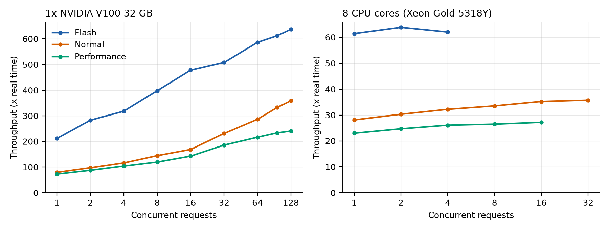

# Speech inference server

A self-hosted speech-to-text server for ONNX speech models (FastConformer encoder with a CTC head and an attention
decoder). It runs on CPU or NVIDIA GPU through ONNX Runtime and serves:

- `POST /v1/transcribe`: transcribe an uploaded audio file of any length (long files are cut at pauses into windows of
  up to 30 s);
- `GET /stream`: live transcription over a WebSocket (needs a streaming model package);
- `GET /health`, `GET /help` (the full API, generated from what this server actually loaded) and `GET /demo` (a
  browser page for uploads, microphone recording and live streaming).

The server ships no model weights. You need access to a model package (see [Model files](#model-files)).

- [Quick start (Docker)](#quick-start-docker)
- [Deployment modes](#deployment-modes): Flash, Normal and Performance
- [Word boost (custom vocabulary)](#word-boost-custom-vocabulary)
- [Model files](#model-files): automatic download or manual placement
- [Installation without Docker](#installation-without-docker)
- [Configuration](#configuration)
- [API](#api)
- [Limitations](#limitations)
- [Security notes](#security-notes)

## Quick start (Docker)

```bash
git clone <this repository's URL> speech-server
cd speech-server

# CPU
docker build -f Dockerfile.cpu -t speech-server:cpu .
# GPU (needs the NVIDIA driver >= 535 and the NVIDIA Container Toolkit on the host)
docker build -f Dockerfile.gpu -t speech-server:gpu .

export SPEECH_API_KEY="$(openssl rand -hex 24)"   # clients must send this key (at least 16 characters)
export HF_TOKEN=hf_...                             # a Hugging Face read token with access to the model repository

docker run --rm --gpus all -p 127.0.0.1:8000:8000 \
  -e SPEECH_API_KEY -e HF_TOKEN -e MODEL_REPO=<owner>/<model-repo> \
  -v speech-models:/models speech-server:gpu
```

For the CPU image, drop `--gpus all` and use `speech-server:cpu`. The examples publish the port on 127.0.0.1 only:
plain HTTP carries the API key and the audio unencrypted, so for remote clients put a TLS reverse proxy in front (see
[Security notes](#security-notes)) rather than publishing the port on all interfaces. The first start downloads the model into the
`speech-models` volume; later starts reuse it. `-e NAME` without a value passes the variable from your shell, so
keys stay out of your shell history and the process list (anyone with access to the Docker daemon can still read a
container's environment with `docker inspect`).

Then:

```bash
curl -s http://127.0.0.1:8000/health
curl -s -H "Authorization: Bearer $SPEECH_API_KEY" --data-binary @audio.wav \
  "http://127.0.0.1:8000/v1/transcribe?lang=th"
```

`docker compose --profile cpu up` (or `--profile gpu`) does the same with `docker-compose.yml`; put the variables in a
`.env` file next to it (and never commit that file). The compose file publishes the port on 127.0.0.1 only
(`BIND=0.0.0.0` to expose it), runs the container read-only without Linux capabilities, and keeps uploads in a
tmpfs.

## Deployment modes

The server has three ways to turn audio into text. They trade speed for accuracy; pick one per deployment, or serve
several on one port and choose per request with `?mode=`.

| | Flash mode | Normal mode (default) | Performance mode |
|---|---|---|---|
| What runs | encoder + CTC head | encoder + attention decoder, greedy | encoder + attention decoder, beam search |
| Settings | `MODES=ctc` (offline) or `MODES=ctc-stream` (streaming) | `MODES=decoder` | `MODES=decoder DECODE=beam BEAM=4`, or per request with `DECODES=greedy,beam` and `?decode=beam` |
| Speed | fastest | 1.1-1.4x slower than Flash | about 2x slower than Normal on GPU |
| Accuracy | lowest of the three | better than Flash | small further gain over Normal |
| Repetition loops | cannot happen | possible (see [Limitations](#limitations)) | possible, less often |
| Punctuation, number formatting (`pnc`, `itn`), timestamps | no `pnc` / `itn`; token timestamps | all | all |

Measured throughput of one model package (FastConformer, about 330 M parameters; Thai test audio, many files at once):

| | GPU (V100, fp16) | CPU (16 threads, fp32) |
|---|---|---|
| Flash (`ctc`) | about 2,600x real time | about 70x real time |
| Normal (`decoder`, greedy) | about 1,850x real time | about 62x real time |
| Performance (`decoder`, beam 4) | about 970x real time | slower; beam search is mainly for GPU |

Your numbers depend on the GPU / CPU, the batch settings and the audio. The GPU figures are for many requests batched
together; a single short request is dominated by fixed overhead (tens of milliseconds), so there the modes are much
closer (on an A100, five 7-15 s clips one at a time: Flash 0.23 s, Normal 0.65 s, Performance 0.73 s in total).

The GPU figures above come from a batch benchmark with fp16 graphs. The released model packages ship fp32 graphs.
[LOADTEST.md](LOADTEST.md) reports end-to-end throughput and latency of this server with them, on one V100 and on 8 CPU
cores, for files and live streams.



**Flash mode** decodes the CTC head directly: no decoder, so no loops and the lowest latency. With a streaming model
package, `ctc-stream` (and the live `/stream` WebSocket) gives partial results as audio arrives. The look-ahead
(`?lookahead=0|4|13`, in 80 ms frames) trades latency for accuracy: 0 is the fastest to react, 13 (about 1.1 s) the
most accurate.

**Normal mode** runs the attention decoder with plain greedy decoding (the most likely token at every step, no
heuristics). It is the default and the best balance for most uses. It can also write punctuation and case
(`?pnc=true`), numbers as digits (`?itn=true`) and segment timestamps.

**Performance mode** keeps the 4 (`BEAM`) best partial transcripts at every step. It is the most accurate setting
and the slowest; use it on a GPU when accuracy matters more than throughput.

Serving several modes on one port, for example `MODES=decoder,ctc`, lets each request choose (`?mode=ctc`); the first
mode is the default. Normal and Performance can be served side by side too: `DECODES=greedy,beam` (`--decodes`) loads
a second decoder engine (sharing the encoder) and each decoder request picks with `?decode=greedy` or `?decode=beam`
(the first listed is the default). A server for every setup:
`MODES=decoder,ctc,ctc-stream,dec-stream DECODES=greedy,beam` with a streaming package (`STREAM_MODEL_*`). With `SHARE_ENCODER=true` (the default) the modes, and the two decoder
searches, share one copy of the encoder, so this costs little extra memory: see [Encoder sharing](#encoder-sharing).

A streaming decoder mode (`dec-stream`, preview) is also available when the streaming package includes a streaming
decoder; see `GET /help`.

The demo page (`GET /demo`) shows these setups as a grid, Flash / Normal / Performance by offline / streaming, with
the combinations this server does not offer greyed out, and a word-boost box where the chosen setup supports it.

### Encoder sharing

The encoder is the largest part of the model. When one server runs both the decoder and CTC modes:

- `--share-encoder` / `SHARE_ENCODER=true` (default): one encoder session serves both modes; one copy of the encoder
  weights in memory. CTC requests use the full encoder graph and ignore the decoder's inputs it also produces, so they
  are slightly slower than with a dedicated CTC graph. The streaming modes (`ctc-stream`, `dec-stream`) likewise share
  one streaming encoder. With `DECODES=greedy,beam`, the beam engine also reuses the greedy engine's encoder and the
  decoder graphs both open (with word boost on, greedy already holds beam's top-k graphs).
- `--no-share-encoder` / `SHARE_ENCODER=false`: each mode loads its own encoder (CTC uses the lighter CTC-only graph,
  unless word boost is on and the package has the `ctc_lp` graph: boosted CTC needs the full encoder's output).
  Uses about one more encoder's worth of memory (measured on an A100 at fp16: about 1.8 GB for decoder + CTC shared,
  2.5 GB unshared); CTC is a little faster.

`GET /health` reports `share_encoder`, and the start-up log names the engines that share an encoder.

## Word boost (custom vocabulary)

Callers can pass names, organisations or other terms that the transcript should spell correctly; decoding is then
biased toward them (shallow fusion). It is opt-in per request: without a list every mode decodes exactly as it does
by default.

```bash
curl -s -H "Authorization: Bearer $SPEECH_API_KEY" --data-binary @audio.wav \
  "http://127.0.0.1:8000/v1/transcribe?mode=decoder&word_boost=Acme%20Corp&word_boost=Jane%20Doe&boost=1.2"
```

- `word_boost`: one phrase per parameter (repeat it), or one JSON list such as
  `["Acme Corp", {"phrase": "Jane Doe", "boost": 1.5}]`. Up to 500 phrases per request, 100 on a live stream, 50
  characters each. Phrases are matched by their text, however the tokenizer splits them, so Thai and Chinese phrases
  need no spaces. Write each phrase as the transcript should show it.
- `boost` (greater than 0, at most 2; default 1): overall strength; a phrase's own `boost` multiplies it.
- `ctc_beam` (1-8, default 4; CTC modes): width of the boosted CTC beam search.
- Live streams (`/stream`, `ctc-stream`) take the same fields in the start message.

How each deployment mode applies it:

| Mode | Files (`POST /v1/transcribe`) | Live / streaming (`ctc-stream`, `/stream`) | Search while a list is active |
|---|---|---|---|
| Flash (`ctc`) | CTC prefix beam search with fusion (`ctc_beam`, default 4); `ctc_beam=1` is a cheaper greedy re-ranking | the same search frame by frame; partials are never revised: text is sent once every beam agrees on it, or after each chunk for all but the last 2 tokens of the best beam | beam 4 (1-8); plain greedy without a list |
| Normal (`decoder`, greedy) | fusion at every greedy step over the step's top 16 tokens | not available: `dec-stream` does not take word boost yet | greedy |
| Performance (`decoder`, beam) | fusion inside the beam search | not available | beam (`BEAM`) |

What it needs from the model package: CTC modes need the `ctc_lp` graph (CTC log-probabilities; `ctc-stream` needs
it in the streaming package), decoder modes need the decoder's top-k graphs (`dec_prefill_topk`, `dec_lean_topk`)
and `gather`. A mode whose package lacks them refuses `word_boost` with a 400 that says so, and `GET /help` lists the
modes that can boost. `--no-word-boost` (`WORD_BOOST=false`) turns the feature off.

Behaviour and limits:

- The bonus only re-ranks tokens among a frame's or step's top candidates (8 for CTC, 16 for the decoder), so it
  helps most where the model hesitates between spellings; it can still write a listed phrase where the model gave it
  a modest probability, which is why lists should be short and the strength tuned. The end of the transcript gets no
  bonus and a bonus never makes the model end early; in greedy decoding an ending the model chose is always kept (a
  beam search lets hypotheses compete on fused scores). The CTC blank gets no bonus
  either, but in the CTC beam search a phrase's bonus can win over a blank the model preferred: that is how a
  boosted phrase gets written, and also how false insertions happen.
- A phrase earns its bonus from its second token on (the model has to start it by itself); a partial match that
  breaks gives its bonus back; each phrase is boosted at most 3 times per 30 s window (offline) or per stream. A
  phrase that is a single token of the vocabulary is therefore not boosted.
- Output changes only where a listed phrase is written: offline (`decoder`, `ctc`, `ctc-stream` uploads), a window
  in which the boosted search completes no listed phrase returns exactly the default output. Live `/stream` sessions
  cannot take text back, so there a list can change the text slightly even where no phrase is said (the boosted
  beam search, and at most the last 2 tokens are held back until the next chunk). In decoder mode, a batch in which
  some window writes no listed phrase is decoded a second time with the default search.
- The strength defaults are starting points, not tuned values: measure on your own development data (recall of the
  listed phrases, false insertions on audio that does not contain them, overall error rate) before raising `boost`.
  Keep lists short: the words the model gets wrong, not every word you expect.
- Boosting can make a decoder write a listed phrase where something similar was said, and it interacts with the
  decoder's repetition failure mode (see [Limitations](#limitations)); the per-phrase cap limits, but does not rule
  out, a boosted phrase being repeated.
- Cost: the boosted searches run on the host in Python; expect a few milliseconds to a few tens of milliseconds per
  second of audio on CPU, more for larger beams; a window that writes no listed phrase is decoded a second time
  with the default search. On GPU, boosted requests also run the CTC log-probability graph (CTC modes) or the top-k
  decoder graphs (decoder modes). Memory: with word boost on (the default),
  decoder engines also load the top-k decoder graphs (unless a beam engine already has them) and CTC engines the
  small `ctc_lp` graph; compiled lists are cached (bounded); `--no-word-boost` avoids all of it.
- A listed phrase that is a suffix of a longer listed phrase is only boosted where it starts a match of its own.
- Token timestamps with word boost: in `ctc`, the boosted tokens are force-aligned to the CTC log-probabilities
  (`token_times` is empty if no alignment exists); in `ctc-stream` with a beam, a token's start / end are the frame
  it was committed at, not the frames it was spoken in.

## Model files

A model package is a directory with `spec.json`, `tokenizer.model`, `mel_stats.json` and the ONNX graphs that
`spec.json` lists (the encoder, CTC and decoder graphs; streaming packages add a front-end graph and chunk-encoder
graphs). A package may be trimmed to the graphs one deployment needs; the server stops at start-up, naming the file,
if a mode you asked for needs a graph that is not there.

Offline packages (decoder / ctc) and streaming packages (ctc-stream / dec-stream and the live WebSocket) are separate:
an offline package cannot stream. To serve both, give one of each (`MODEL_*` and `STREAM_MODEL_*`).

### Option 1: automatic download from Hugging Face

Set the repository and, for a private or gated repository, a read token:

```bash
export MODEL_REPO=<owner>/<model-repo>            # offline model (decoder / ctc)
export STREAM_MODEL_REPO=<owner>/<streaming-repo>  # optional: streaming model
export MODEL_REVISION=main                         # optional: branch, tag or commit to pin
export HF_TOKEN=hf_...                             # needed only for private / gated repositories
python -m speech_server serve                      # or the Docker command above
```

The files are downloaded once into `MODEL_CACHE` (default `~/.cache/speech-server`; `/models` in the Docker images,
which you should mount as a volume) under `<owner>@<repo>/` (`<owner>@<repo>@<revision>/` when a revision is
pinned), and reused on later starts; an interrupted download resumes. You need read access to the repository on Hugging Face (accept its terms if it is gated, and create a
read token at https://huggingface.co/settings/tokens). The token is read from the environment only (the variable is
`HF_TOKEN`; `--hf-token-env` names another); it is never a command-line flag and never logged, and the server removes
it from its own environment once the downloads are done. Without a token, `huggingface_hub` falls back to a login
saved with `huggingface-cli login`, if there is one. Pin
`MODEL_REVISION` to a commit for reproducible deployments.

### Option 2: download and place the files yourself

1. Download the model repository with any tool, for example:

   ```bash
   pip install -U huggingface_hub
   huggingface-cli login                       # once, if the repository is private or gated
   huggingface-cli download <owner>/<model-repo> --local-dir ./models/offline
   huggingface-cli download <owner>/<streaming-repo> --local-dir ./models/streaming   # optional
   ```

   or copy the files from wherever you received them. The result should look like:

   ```
   models/
     offline/
       spec.json
       tokenizer.model
       mel_stats.json
       encoder5.fp32.onnx            # graph files as listed in spec.json "graphs"
       encoder5_ctc.fp32.onnx
       cross_kv3.fp32.onnx
       dec_prefill_argmax.fp32.onnx
       dec_lean_argmax.fp32.onnx
       ...
     streaming/                      # optional
       spec.json
       tokenizer.model
       mel_stats.json
       frontend.fp32.onnx
       encoder_chunk_c1.fp32.onnx
       ...
   ```

   Large ONNX models keep their weights in a companion file (`*.onnx.data`); keep it next to its `.onnx` file.

2. Point the server at the directories:

   ```bash
   python -m speech_server serve --model ./models/offline --stream-model ./models/streaming
   ```

   With Docker, mount them read-only and set `MODEL_DIR` / `STREAM_MODEL_DIR`:

   ```bash
   docker run --rm --gpus all -p 127.0.0.1:8000:8000 -e SPEECH_API_KEY \
     -v "$PWD/models:/local-models:ro" \
     -e MODEL_DIR=/local-models/offline -e STREAM_MODEL_DIR=/local-models/streaming \
     speech-server:gpu
   ```

   With `docker compose`, put the files in `./models` and set `MODEL_DIR=/local-models/offline` in `.env`.

`MODEL_DIR` (a local directory) wins over `MODEL_REPO` when both are set.

## Installation without Docker

Requirements: Linux x86_64 (macOS and Windows may work for CPU but are not tested), Python 3.10-3.12, and for GPU an
NVIDIA GPU of compute capability 7.0 or newer (V100, T4, A10, A100, L4, H100, RTX 20xx and newer) with driver >= 535 (CUDA 12 minor-version compatibility; 550 or newer recommended).
ffmpeg is optional: it adds M4A / MP4 / WebM / AAC / AMR uploads (WAV, FLAC, OGG and MP3 work without it).

GPU memory: the encoder runs a whole batch of 30 s windows at once (`--batch-size`, `--max-batch-seconds`), inside its
share of `--gpu-mem-limit-mb`, which also limits the seconds per batch (about twice as tightly for fp32 graphs as for fp16).
The value sets a cap per ONNX Runtime session (the encoder 45%, each decoder graph 2 to 10%) plus at most 25% for decoder
buffers, not one total for the process: the caps can add up to more, for example with word boost or with several modes
or look-aheads loaded.
Every 8th encoder batch (`--gpu-arena-shrink-every`, env `GPU_ARENA_SHRINK_EVERY`) the server releases the encoder's
unused GPU memory from ONNX Runtime's arena, so memory does not fragment over a long run of differently sized batches
(about 1.5% of throughput; `1` releases after every batch, about 5%). With `0` (never) and a `--gpu-mem-limit-mb` cap,
fp32 graphs can run out of memory after a few dozen batches of varied length; without a cap, on a GPU of its own, `0`
is fine. If a GPU still runs out of memory, lower `--max-batch-seconds`, or raise the cap toward the GPU's size.

```bash
python -m venv .venv && . .venv/bin/activate
pip install -r requirements-cpu.txt      # CPU
# or
pip install -r requirements-gpu.txt      # GPU: onnxruntime-gpu plus NVIDIA's CUDA 12 / cuDNN 9 pip wheels
sudo apt-get install -y ffmpeg           # optional

export SPEECH_API_KEY="$(openssl rand -hex 24)"
python -m speech_server serve --model ./models/offline --device cuda --port 8000   # listens on 127.0.0.1
```

The GPU requirements install the CUDA and cuDNN libraries as pip wheels, so no system CUDA toolkit is needed; the
server loads them at start-up. If you already have CUDA 12 and cuDNN 9 installed system-wide you can install just
`onnxruntime-gpu` and the remaining packages. The server never falls back to the CPU silently: if CUDA cannot be
used it stops with an error.

Transcribing files without a server:

```bash
python -m speech_server transcribe --model ./models/offline --device cpu --threads 8 a.wav b.flac > out.jsonl
```

## Configuration

Every setting is a command-line flag; the common ones also have an environment variable (used by the Docker images),
validated exactly like the flag (an invalid value stops the server with a message). Precedence: command line, then
environment, then a JSON `--config` file, then the defaults. The CPU image presets `DEVICE=cpu`, which therefore
outranks a `--config` file's `device`. `python -m speech_server
serve --help` lists every flag.

| Environment variable | Flag | Default | Meaning |
|---|---|---|---|
| `SPEECH_API_KEY` | `--api-key-env` / `--api-key-file` | (required) | key clients send as `Authorization: Bearer <key>` (or `X-API-Key: <key>`); at least 16 characters |
| `MODEL_DIR` | `--model` | | local offline model directory |
| `MODEL_REPO`, `MODEL_REVISION` | `--model-repo`, `--model-revision` | | Hugging Face repository to download |
| `STREAM_MODEL_DIR` | `--stream-model` | | local streaming model directory |
| `STREAM_MODEL_REPO`, `STREAM_MODEL_REVISION` | `--stream-model-repo`, `--stream-model-revision` | | streaming repository |
| `MODEL_CACHE` | `--model-cache` | `~/.cache/speech-server` (`/models` in Docker) | download location |
| `HF_TOKEN` | `--hf-token-env` (names the variable) | | Hugging Face read token |
| `DEVICE` | `--device` | `cuda` (`cpu` in the CPU image) | `cpu` or `cuda` |
| `PRECISION` / `PRECISIONS` | `--precision` / `--precisions` | `fp16` on GPU if the package has fp16 graphs, else `fp32` | numeric precision (on CPU the default is fp32; fp16 asked for explicitly runs, but slowly) |
| `MODE` / `MODES` | `--mode` / `--modes` | `decoder` | served modes, first is the default: `decoder`, `ctc`, `ctc-stream`, `dec-stream` |
| `DECODE`, `BEAM` | `--decode`, `--beam` | `greedy`, `4` | decoder search (Performance mode: `beam`; beam 1-16) |
| `DECODES` | `--decodes` | `DECODE` | decoder searches served per request (`?decode=`), e.g. `greedy,beam`; the first is the default |
| `GPU_ARENA_SHRINK_EVERY` | `--gpu-arena-shrink-every` | `8` | GPU: release the encoder's unused arena memory every Nth batch (1 = always, 0 = never); see "GPU memory" |
| `STATS` | `--stats` | off | serve `GET /stats` (API key required): per-engine timings, effective batch limits after the memory clamp, micro-batch sizes, 503 counts; for tuning |
| `SHARE_ENCODER` | `--share-encoder` / `--no-share-encoder` | `true` | see [Encoder sharing](#encoder-sharing) |
| `THREADS` | `--threads` | all cores | CPU threads per engine (set it to your container's CPU limit) |
| `LANG_DEFAULT` | `--lang` | `auto` | default language prompt (`auto`, `th`, `en`, `zh`) |
| `HOST`, `PORT` | `--host`, `--port` | `127.0.0.1`, `8000` (`0.0.0.0` in Docker) | listen address |
| `MAX_STREAMS` | `--max-streams` | `4` | concurrent live WebSocket sessions |
| `MODEL_NAME` | `--model-name` | `model` | name reported by `/health` |
| `WORD_BOOST` | `--word-boost` / `--no-word-boost` | `true` | accept per-request `word_boost` lists |

Other limits are flags with safe defaults (see `--help`): upload size (`--max-body-mb`, 1024 MB), audio length
(`--max-audio-s`, 1 h), decoded audio held at once (`--inflight-audio-s`), time-outs and WebSocket pacing.
`speech_server/configs/` has example `--config` files for CPU / GPU and CTC / decoder deployments.

## API

Full reference: `GET /help` on a running server (Markdown; `?format=json` for JSON), or
[`speech_server/USAGE.md`](speech_server/USAGE.md). In short:

- `POST /v1/transcribe` with the audio file as the request body. Query parameters: `mode`, `decode` (where served),
  `precision`, `lang`
  (`auto`, `th`, `en`, `zh`), `itn`, `pnc`, `timestamps` (`none`, `segment`, `token`), `lookahead` (streaming modes).
  The response has `text`, the per-window `segments`, `audio_seconds` and timing. Invalid values are a 400 with the
  reason; too long a file is a 413; a busy server is a 503 with `Retry-After`.
- `GET /stream`: WebSocket. The first message is `{"type": "start", "key": "<key>", "lookahead": 4}` (or send the key
  in the `Authorization` header of the upgrade); then binary 16 kHz mono 16-bit PCM frames at up to twice real time;
  the server sends `partial` messages as text appears, and a `final` message after `{"type": "stop"}`, an idle period
  or the session limit.
- `GET /health`: served modes, precisions and whether live streaming is on (no key needed).
- `GET /stats` (only with `--stats` / `STATS=true`; needs the key): per-engine counters for tuning (encode / decode
  seconds, windows, micro-batches and their mean size, the effective `max_batch_seconds` and KV budget, 503 counts).
  Numbers only: no audio, text or request details.

Put the server behind a TLS-terminating reverse proxy (nginx, Caddy, a cloud load balancer) for anything beyond
localhost; browsers need HTTPS for the microphone on `/demo`.

## Limitations

- **The decoder can loop.** In Normal and Performance modes the attention decoder occasionally repeats a word or
  phrase over and over instead of moving on, until it reaches the token limit (`--max-new-tokens`, default 448 per
  30 s window). This is a property of attention decoders, not a server bug. It happens most on far-field or noisy
  recordings, overlapping speakers, long silences or music, and very short or cut-off clips. Greedy decoding is plain
  greedy: the server applies no loop detection or fallback of its own, so what you get is what the model wrote.
  If loops matter for your use:
  - use Flash mode (`ctc`), which cannot loop;
  - or serve `MODES=decoder,ctc` and re-run a request with `?mode=ctc` when the decoder output looks repetitive (for
    example, the same short phrase many times in a row, or text much longer than the audio could hold);
  - Performance mode (beam search) loops less often than greedy, but not never.
- **Streaming needs a streaming model package**; an offline package serves only `decoder` and `ctc`. Streaming CTC
  (`ctc-stream`) handles at most about 12 minutes per stream; the live WebSocket session ends at that point with a
  `final` message.
- **`dec-stream` is a preview**: the streaming decoder's accuracy and latency are not yet characterised, and it can
  also loop.
- **Segment timestamps** (`timestamps=segment`) come from the decoder's timestamp tokens, which the model saw in only
  a small part of its training data; their quality is not guaranteed. Token timestamps (`timestamps=token`) come from
  the CTC head and are more reliable, at 80 ms resolution.
- **Languages**: the server offers Thai, English and Chinese by default (those of them the model has; `--langs`), the
  languages the models were trained for. Other language tokens exist in the vocabulary but were not trained.
- **Audio input**: at most 8 channels (mixed down to mono) and sample rates of 4-384 kHz; everything is resampled to
  16 kHz.
- **Precision**: fp16 needs a package with fp16 graphs and is meant for GPUs (on CPU the default is fp32; an explicit
  fp16 runs, but slower); int8 is CPU only and needs int8 graphs. The streaming graphs are fp32 only.
- **GPU support**: NVIDIA GPUs of compute capability 7.0+ through ONNX Runtime's CUDA execution provider; the
  TensorRT execution provider (`--provider TensorRT`) is optional and untested on some GPUs. Other accelerators are not
  supported.

## Security notes

- An API key of at least 16 characters is required unless you run with `--no-auth`, which is allowed only on a
  loopback address (and then any web page open in a browser on that machine can reach the server). The key is never
  accepted on the command line: use `SPEECH_API_KEY` (or `--api-key-env`) or `--api-key-file` (the file must be mode
  0600). Requests, transcripts and keys are not logged.
- Serve remote clients through a TLS-terminating reverse proxy: the key travels in a request header, and a proxy also
  absorbs slow or idle connections (the server itself caps connections, `--http-max-conns`, and times out request
  heads, `--http-head-s`, but a crowd of slow clients can still fill those slots). Rate limits per client belong in the
  proxy too.
- Uploads are size- and duration-limited, decoded with a time limit, and held in memory against a server-wide budget;
  connections that send too slowly are dropped. Defaults are in `--help`.
- Only real audio / video containers are decoded; playlists and files that reference other files or URLs are refused.
  The ffmpeg / ffprobe processes that parse uploads get a minimal environment (no keys or tokens).
- The Docker images run as an unprivileged user. Keep `.env` files and tokens out of version control.

## License

Apache License 2.0; see [LICENSE](LICENSE). Model weights are not part of this repository and come with their own
license terms.
